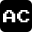

<div align="center">
    
    <h1>Alexander Choukeir's Portfolio Website</h1>
</div>

[](LICENSE)

Welcome to my portfolio website ([alexchoukeir.com](https://www.alexchoukeir.com))! This web application was built using Next.js. It showcases my projects, skills, and contact information.

## 🚀 Key Features

- **Modern, stunning UI**: Designed to be highly visually appealing using the latest design trends.
- **Responsive Design**: Automatically adapts to any screen size, ensuring a seamless browsing experience on desktop, tablet and mobile.

## 🛠️ Tech Stack

- **Frontend**: Next.js, Vinext
- **Deployment and Infrastructure**: Cloudflare
- **Tooling and Workspace**: pnpm

## 📁 Project Structure

```plaintext
portfolio-website/
│
├── app/            # Routing and layout
├── components/     # Components used to build different sections of the website
├── data/           # Website data (projects, skills)
├── public/         # Static assets
├── package.json    # Project configuration file
└── README.md       # README file
```

## 🚀 Getting Started

### Prerequisites

- **pnpm**
- **Node.js**

### Setup

1. **Clone the repository**

```bash
git clone https://github.com/alexchoukeir/portfolio-website.git
cd portfolio-website
```

2. **Install Dependencies**

```bash
pnpm install
```

3. Running the project

```bash
pnpm dev
```

- **Next.js frontend**: `localhost:3000`

## License

This project is licensed under the [MIT License](License)
